# SSAFY HOME - JSP to Vue SPA Migration

기존 JSP 기반 화면 렌더링 구조를 Vue SPA 프론트엔드와 Spring REST API 백엔드로 분리한 프로젝트입니다.

이번 구현의 핵심은 기존 Spring MVC + JSP 화면을 유지하던 구조에서, 화면은 Vue가 담당하고 백엔드는 JSON API만 제공하는 구조로 전환한 것입니다. 인증은 기존 프로젝트의 방향을 유지해 Spring Security 세션 방식으로 처리했습니다.

<br>

## 프로젝트 구조

```text
pjt11_buk03_15_09
├─ backend/                # Spring Boot REST API 서버
│  ├─ batch/               # 부동산 실거래 데이터 수집/저장/요약/PDF 배치
│  │  ├─ ai/               # AI 요약 서비스
│  │  ├─ config/           # Spring Batch Job/Step 설정
│  │  ├─ dao/              # 배치 데이터 접근 계층
│  │  ├─ domain/           # 배치 도메인 객체
│  │  ├─ pdf/              # PDF 리포트 생성
│  │  ├─ scheduler/        # 배치 스케줄 실행
│  │  ├─ shared/           # 배치 공통 객체
│  │  └─ tasklet/          # 수집/저장/요약/PDF Tasklet
│  ├─ config/              # Swagger, 애플리케이션 설정
│  ├─ controller/          # API 컨트롤러와 공통 예외 처리
│  │  ├─ advice/           # REST API 예외 응답 처리
│  │  └─ api/              # Vue에서 호출하는 REST API 엔드포인트
│  ├─ filter/              # 요청 로깅 등 Servlet Filter
│  ├─ model/
│  │  ├─ dto/              # 요청/응답 및 도메인 데이터 객체
│  │  ├─ mapper/           # MyBatis Mapper 인터페이스
│  │  └─ service/          # 비즈니스 로직
│  ├─ security/            # Spring Security 세션 인증/인가
│  ├─ util/                # 공통 유틸리티
│  └─ resources/
│     └─ mappers/          # MyBatis XML SQL Mapper
├─ frontend/               # Vue SPA 클라이언트
│  └─ src/
│     ├─ api/              # Axios 기반 REST API 호출 모듈
│     ├─ components/       # 헤더, 푸터, 지도, 목록 등 재사용 UI
│     ├─ views/            # 라우터에 연결되는 페이지 단위 화면
│     ├─ router/           # Vue Router 경로 설정
│     ├─ utils/            # 날짜 포맷, Kakao SDK 로더 등 공통 유틸
│     ├─ App.vue           # 공통 레이아웃
│     └─ main.js           # Vue 앱 진입점
```

<br>

## 기술 스택

| 영역     | 기술                                            |
| -------- | ----------------------------------------------- |
| Frontend | Vue 3, Vue Router, Vite, Axios, pnpm            |
| Backend  | Java 21, Spring Boot 3.5.x, Spring MVC REST API |
| Security | Spring Security, Session, JSESSIONID Cookie     |
| Database | MySQL 8.x, MyBatis XML Mapper                   |
| Map      | Kakao Map JavaScript SDK                        |
| API 문서 | springdoc-openapi / Swagger UI                  |
| Data     | 공공데이터 기반 주택/상권 데이터                |

<br>

## 전환 전후 구조

### 기존 JSP 구조

```text
브라우저
→ Spring Controller
→ JSP View 반환
→ 서버가 HTML 렌더링
→ 브라우저에 완성된 HTML 응답
```

기존에는 `AuthController`, `BoardController`, `NoticeController`, `HouseInfoController` 같은 컨트롤러가 JSP view name을 반환했습니다.

### 현재 Vue SPA + REST API 구조

```text
브라우저
→ Vue SPA 라우터가 화면 전환
→ Axios로 Spring REST API 호출
→ Spring은 JSON 응답
→ Vue가 응답 데이터를 화면에 렌더링
```

현재 백엔드는 JSP 화면을 반환하지 않고 `/api/**` 경로의 REST API를 제공합니다. 프론트엔드는 `frontend/src/views`의 페이지와 `frontend/src/components`의 재사용 UI 컴포넌트로 구성됩니다.

<br>

## 구현 기능

### F1102. 부동산 주택 실거래가 검색

구현 내용:

- 기존 JSP 주택 검색 화면을 Vue SPA 화면으로 이전
- 시도/시군구/읍면동 선택 목록을 Vue에서 동적으로 조회
- 선택한 지역 코드, 동명, 아파트명을 조건으로 주택 실거래가 검색
- 검색 결과를 Vue 화면에서 목록과 지도에 함께 표시
- 백엔드는 `GET /api/houses` REST API로 JSON 데이터 제공

관련 화면 및 코드:

- `frontend/src/views/HomeView.vue`
- `frontend/src/views/HouseListView.vue`
- `frontend/src/api/houses.js`
- `frontend/src/api/regions.js`

구현 화면:

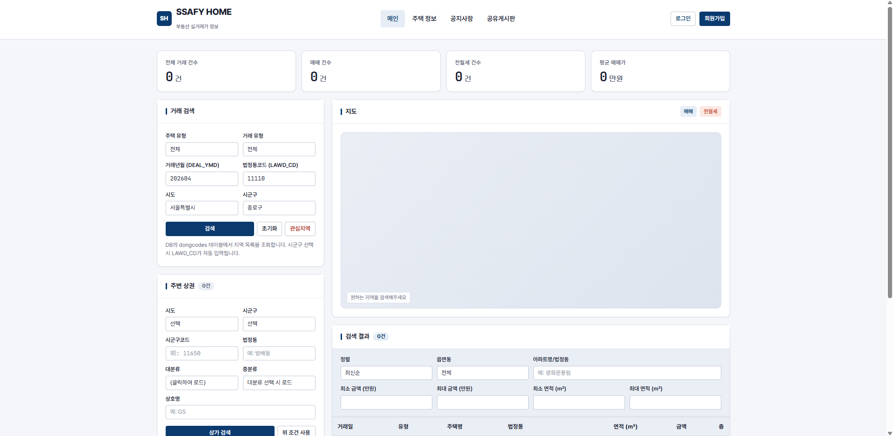
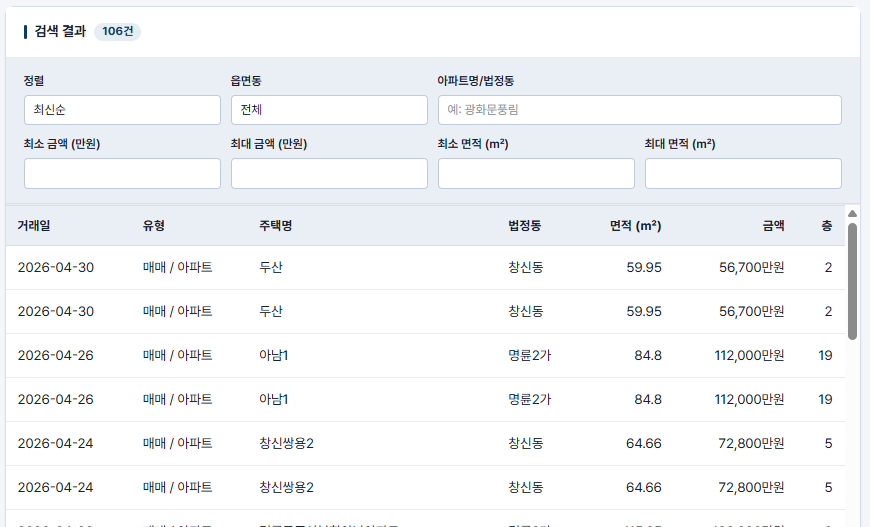
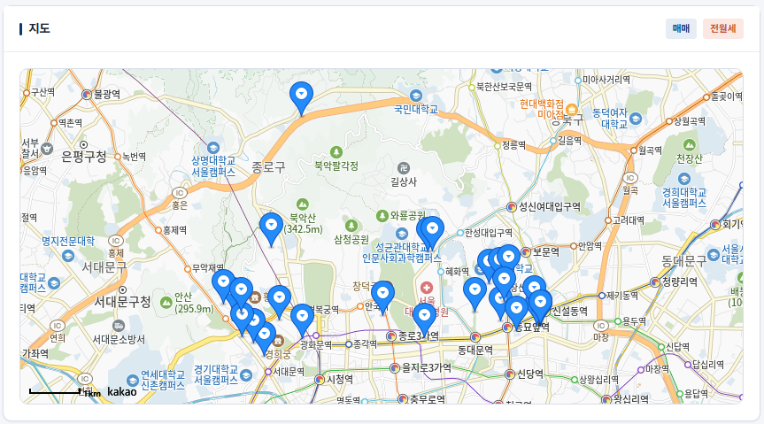

<br>

### F1103. 부동산 관심 지역 정보 관리

구현 내용:

- 기존 JSP 마이페이지의 관심지역 영역을 Vue 화면으로 이전
- 로그인한 사용자의 관심지역 목록 조회
- 관심지역 삭제 기능을 REST API로 연결
- 세션 로그인 상태를 기준으로 사용자별 관심지역만 표시

관련 화면 및 코드:

- `frontend/src/views/MyPageView.vue`
- `frontend/src/api/favorites.js`
- `backend/src/main/java/com/ssafy/prj/controller/api/FavoriteApiController.java`

구현 화면:

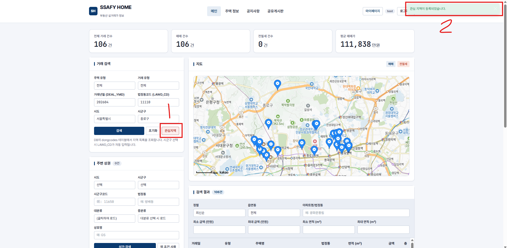
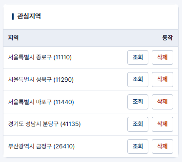

<br>

### F1104. 부동산 주변탐방 정보 수집

구현 내용:

- 공공데이터포털의 소상공인시장진흥공단 상가(상권)정보 CSV 활용
- 원본 약 272만 행 데이터를 1/100 경량 샘플로 변환
- 17개 시도별 샘플 CSV를 `data/summary/commercials_<region>.csv` 형태로 생성
- `commercials`, `commercial_categories` 테이블에 상권 데이터 적재
- MySQL `local_infile` 권한 문제를 피하기 위해 Java batch insert 로더 추가

관련 파일:

- `scripts/sample_commercials.py`
- `scripts/LoadCommercialSummary.java`
- `sql/load_commercials_summary.sql`

구현 화면:

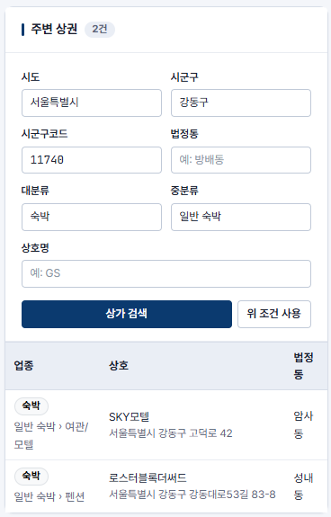
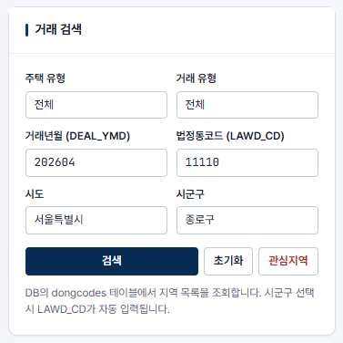

<br>

### F1105. 부동산 주변탐방 업종 정보 검색

구현 내용:

- 기존 JSP 상권 검색 UI를 Vue 메인 화면으로 이전
- 업종 대분류/중분류 목록을 REST API로 조회
- 시군구 코드, 업종, 키워드 조건으로 주변 상권 검색
- 2026년 상권 데이터의 업종 코드 체계에 맞춰 Vue 검색 조건 연결

관련 화면 및 코드:

- `frontend/src/views/HomeView.vue`
- `frontend/src/api/commercials.js`
- `backend/src/main/java/com/ssafy/prj/controller/api/CommercialApiController.java`

구현 화면:


<br>

### F1111. 커뮤니티 공지사항 관리

구현 내용:

- 기존 JSP 공지사항 목록/상세/등록/수정 화면을 Vue로 이전
- 공지사항 목록 조회와 키워드 검색 제공
- 공지사항 상세 조회 제공
- 관리자 권한으로 공지사항 등록, 수정, 삭제 가능
- 기존 form submit 방식에서 Axios 기반 REST 요청 방식으로 전환

관련 화면 및 코드:

- `frontend/src/views/NoticeListView.vue`
- `frontend/src/views/NoticeDetailView.vue`
- `frontend/src/views/NoticeFormView.vue`
- `frontend/src/api/notices.js`

구현 화면:

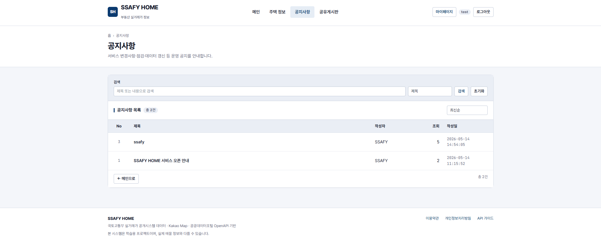
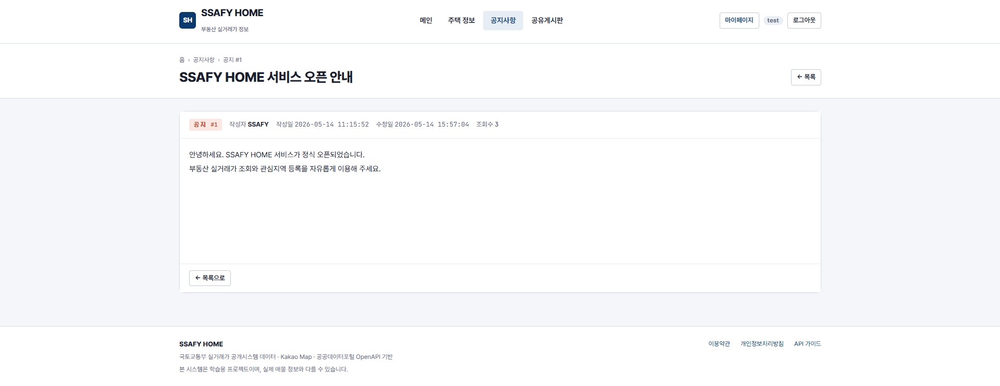

<br>

### F1112. 회원 등록

구현 내용:

- 기존 JSP 회원가입 화면을 Vue 화면으로 이전
- 회원가입 폼 입력값을 JSON으로 전송
- `POST /api/members` REST API로 회원 등록
- 회원가입 완료 후 로그인 화면으로 이동

관련 화면 및 코드:

- `frontend/src/views/RegisterView.vue`
- `frontend/src/api/auth.js`
- `backend/src/main/java/com/ssafy/prj/controller/api/MemberApiController.java`

구현 화면:

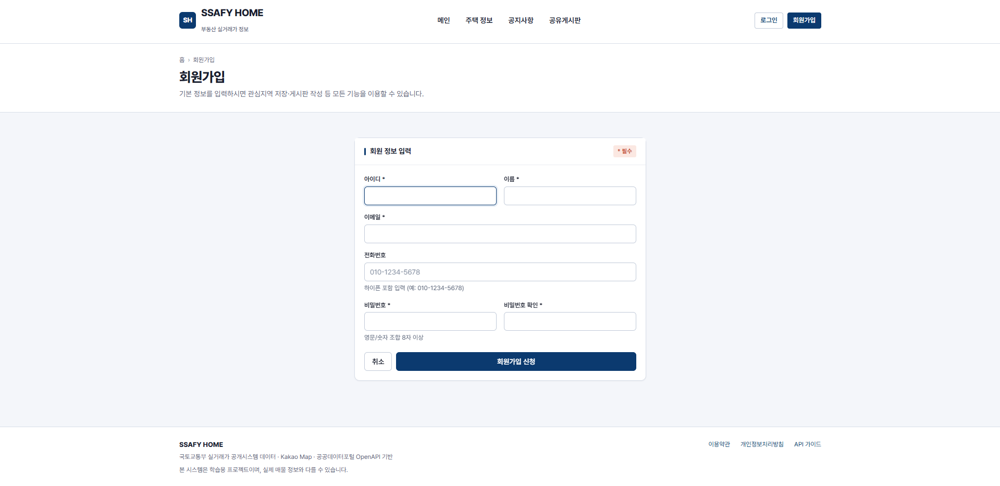

<br>

### F1113. 회원 조회

구현 내용:

- 기존 JSP 마이페이지와 관리자 회원 목록 화면을 Vue로 이전
- 로그인한 사용자의 회원 정보 조회
- 관리자 권한으로 전체 회원 목록 조회
- 세션 쿠키 기반으로 현재 사용자 정보를 유지

관련 화면 및 코드:

- `frontend/src/views/MyPageView.vue`
- `frontend/src/views/AdminUsersView.vue`
- `frontend/src/api/auth.js`
- `frontend/src/api/admin.js`

구현 화면:

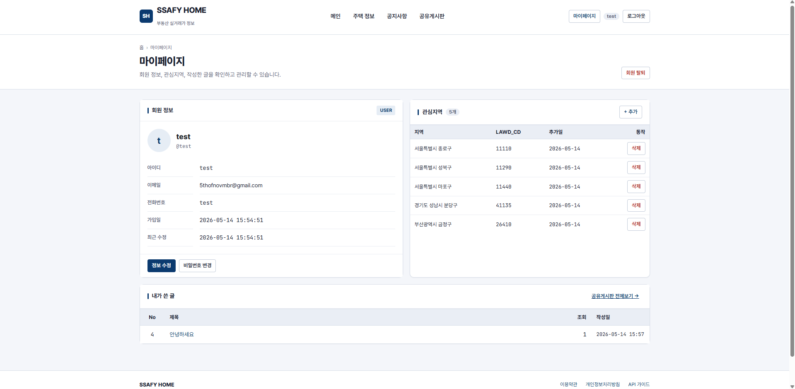
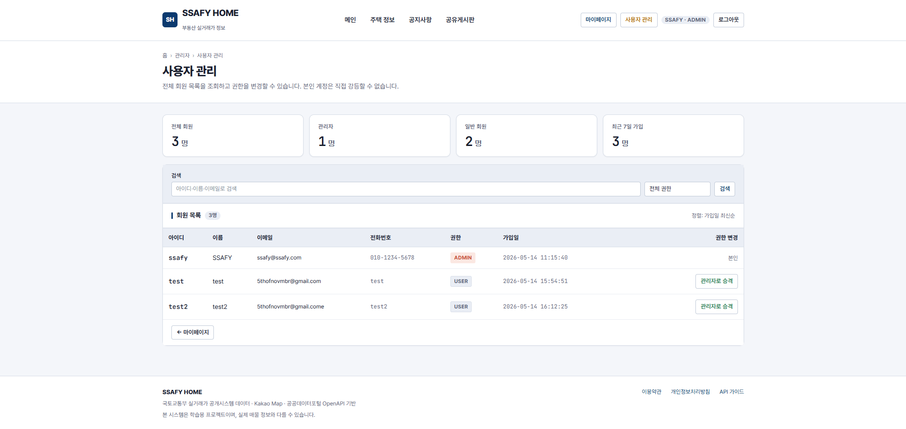

<br>

### F1114. 회원 수정

구현 내용:

- 마이페이지에서 회원 정보 수정 기능을 Vue 화면으로 이전
- 로그인한 사용자의 이름, 이메일, 전화번호 등 회원 정보 수정
- Axios를 통해 회원 수정 REST API 호출
- 수정 후 현재 사용자 정보를 다시 조회하여 화면 상태 갱신

관련 화면 및 코드:

- `frontend/src/views/MyPageView.vue`
- `frontend/src/api/auth.js`
- `backend/src/main/java/com/ssafy/prj/controller/api/MemberApiController.java`

구현 화면:

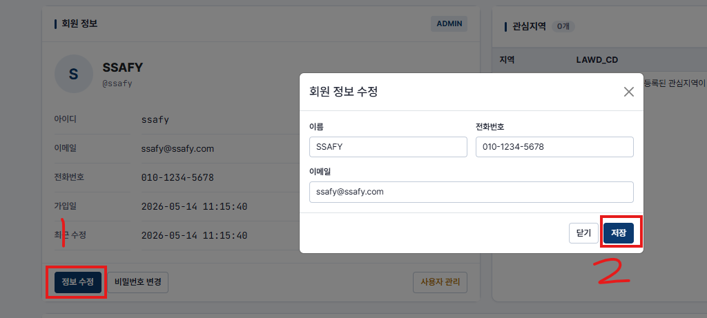
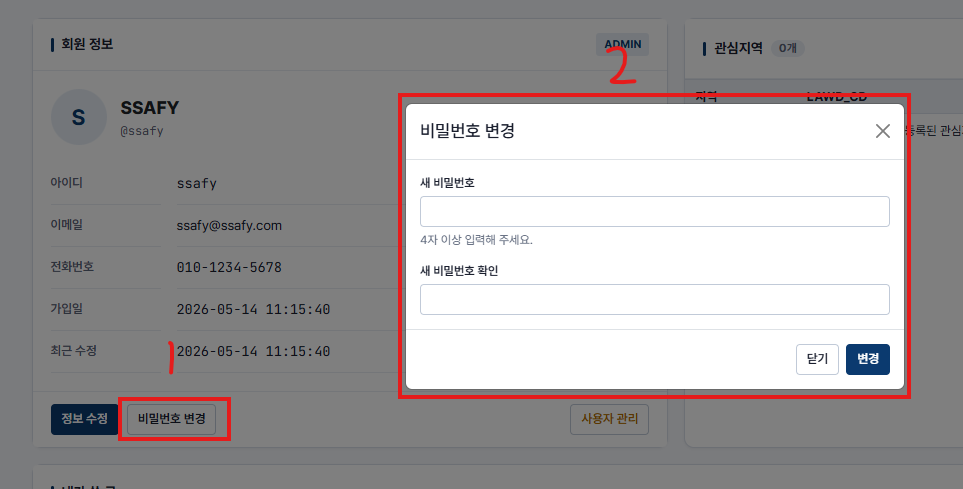

<br>

### F1115. 회원 삭제

구현 내용:

- 마이페이지에서 회원 탈퇴 기능을 Vue 화면으로 이전
- 관리자 화면에서 회원 삭제 기능 제공
- 삭제 전 확인 모달을 표시해 실수 삭제 방지
- 삭제 후 세션 상태와 화면 목록 갱신

관련 화면 및 코드:

- `frontend/src/views/MyPageView.vue`
- `frontend/src/views/AdminUsersView.vue`
- `frontend/src/components/ConfirmModal.vue`
- `frontend/src/api/admin.js`

구현 화면:


<br>

### F1116. 회원 로그인 관리

구현 내용:

- 기존 JSP 로그인/로그아웃 화면과 처리를 Vue + REST API 방식으로 이전
- `POST /api/auth/login`으로 JSON 로그인 요청
- Spring Security 인증 성공 시 서버 세션에 `SecurityContext` 저장
- 브라우저는 `JSESSIONID` 쿠키로 로그인 상태 유지
- `POST /api/auth/logout`으로 세션 무효화
- 인증 실패와 권한 없음 응답은 HTML redirect가 아닌 JSON으로 반환

관련 화면 및 코드:

- `frontend/src/views/LoginView.vue`
- `frontend/src/api/auth.js`
- `backend/src/main/java/com/ssafy/prj/controller/api/AuthApiController.java`
- `backend/src/main/java/com/ssafy/prj/security/config/CustomSecurityConfig.java`

구현 화면:

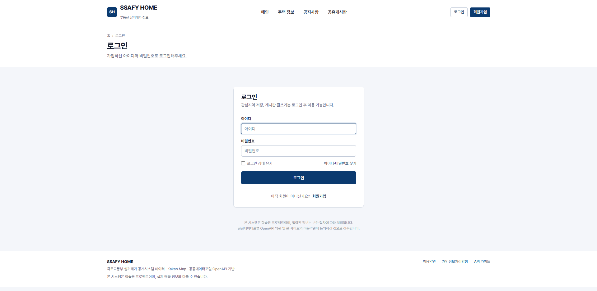


<br>

### F1120. 기타 주택 정보 관리

구현 내용:

- 기존 JSP 주택 정보 목록/상세/수정 화면을 Vue로 이전
- 주택 기본 정보와 최근 거래 내역을 상세 화면에서 제공
- Kakao 지도에 주택 위치 표시
- 관리자 권한으로 주택명, 건축연도, 위도, 경도 수정
- 백엔드는 주택 정보 관리 API를 JSON으로 제공

관련 화면 및 코드:

- `frontend/src/views/HouseListView.vue`
- `frontend/src/views/HouseDetailView.vue`
- `frontend/src/views/HouseFormView.vue`
- `frontend/src/components/KakaoMap.vue`
- `frontend/src/api/houses.js`

구현 화면:

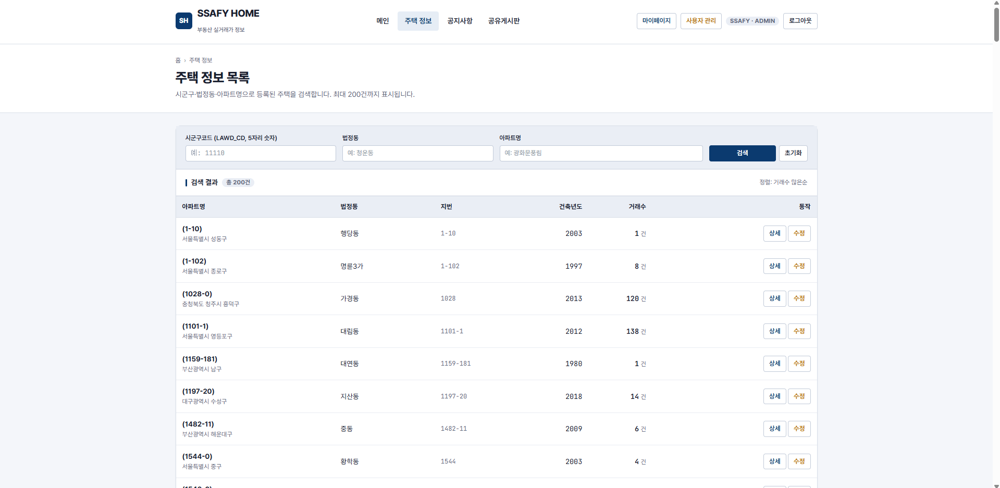
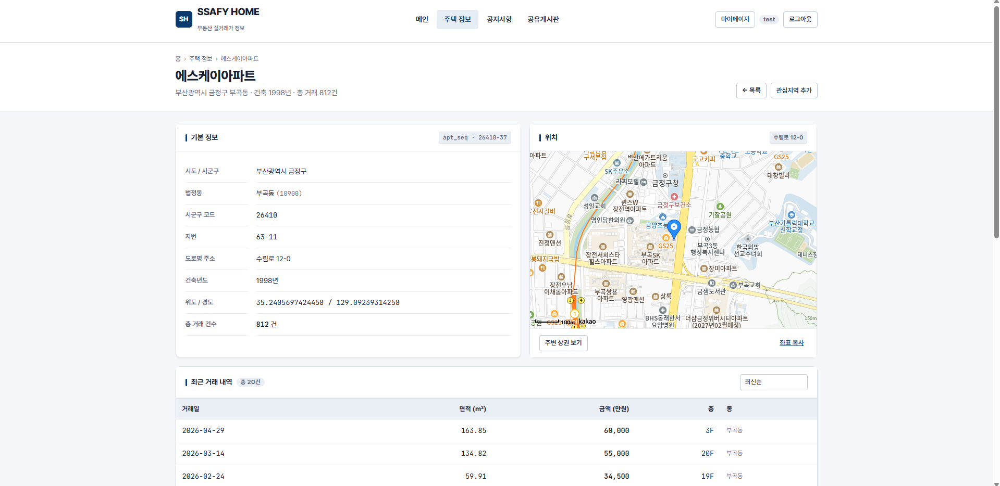
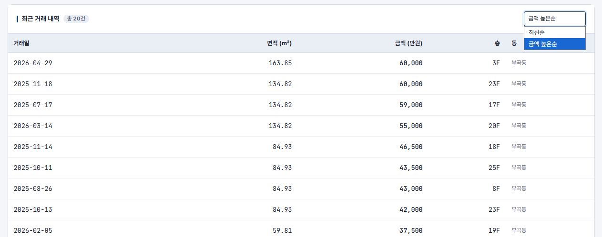
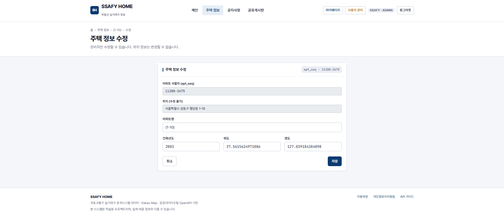

<br>

### F1121. 기타 공유게시판

구현 내용:

- 기존 JSP 공유게시판 목록/상세/등록/수정 화면을 Vue로 이전
- 게시글 목록 조회와 키워드 검색 제공
- 게시글 상세 조회 시 조회수 증가
- 로그인 사용자는 게시글 등록 가능
- 작성자 또는 관리자는 게시글 수정/삭제 가능
- 기존 form submit 방식에서 Axios 기반 REST 요청 방식으로 전환

관련 화면 및 코드:

- `frontend/src/views/BoardListView.vue`
- `frontend/src/views/BoardDetailView.vue`
- `frontend/src/views/BoardFormView.vue`
- `frontend/src/components/ArticleList.vue`
- `frontend/src/components/ArticleForm.vue`
- `frontend/src/api/boards.js`

구현 화면:

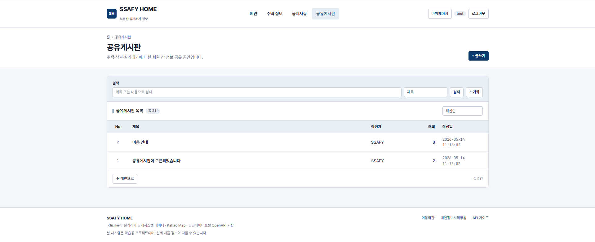
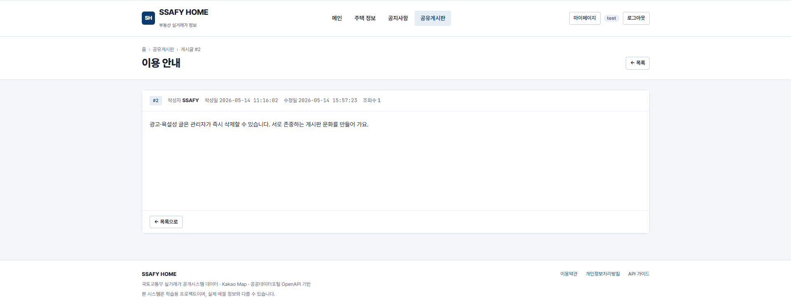
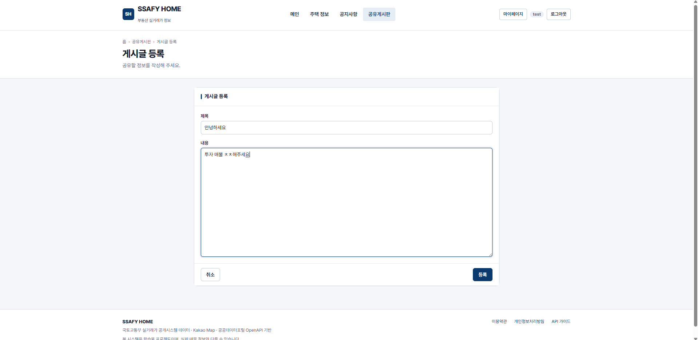
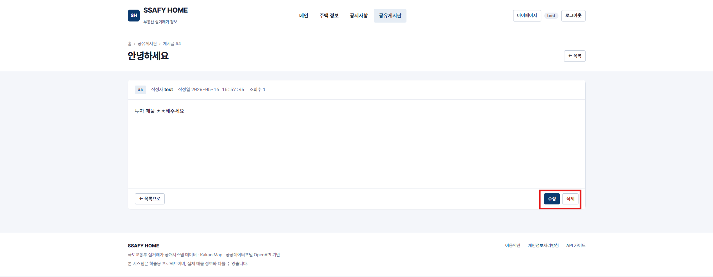

<br>

## 실행 방법

### 1. DB 준비

MySQL에 `ssafy_home` 스키마와 기본 데이터를 적재합니다.

```powershell
mysql -u ssafy -p --default-character-set=utf8mb4 ssafy_home < sql\SSAFY_HOME_Schema.sql
mysql -u ssafy -p --default-character-set=utf8mb4 ssafy_home < sql\SSAFY_HOME_Dump_2604.sql
mysql -u ssafy -p --default-character-set=utf8mb4 ssafy_home < sql\users_and_favorites.sql
mysql -u ssafy -p --default-character-set=utf8mb4 ssafy_home < sql\notices.sql
mysql -u ssafy -p --default-character-set=utf8mb4 ssafy_home < sql\boards.sql
mysql -u ssafy -p --default-character-set=utf8mb4 ssafy_home < sql\commercials.sql
```

### 2. 상권 데이터 경량 샘플 생성

공공데이터포털에서 `소상공인시장진흥공단 상가(상권)정보` 파일 데이터를 다운로드한 뒤, 압축 해제 폴더를 아래 위치에 둡니다.

```text
data/소상공인시장진흥공단_상가(상권)정보_20260331/
```

경량 샘플 CSV를 생성합니다.

```powershell
python scripts\sample_commercials.py
```

생성 결과:

```text
data/summary/commercials_seoul.csv
data/summary/commercials_gyeonggi.csv
...
data/summary/commercials_jeju.csv
```

### 3. 상권 데이터 적재

MySQL `local_infile`이 허용된 환경이라면 SQL 스크립트를 사용할 수 있습니다.

```powershell
mysql -u ssafy -p --local-infile=1 ssafy_home < sql\load_commercials_summary.sql
```

`local_infile` 권한이 없으면 Java 로더로 적재합니다.

```powershell
javac -cp C:\Users\hhy\.m2\repository\com\mysql\mysql-connector-j\9.7.0\mysql-connector-j-9.7.0.jar -d C:\tmp\commercial-load scripts\LoadCommercialSummary.java
java -cp "C:\tmp\commercial-load;C:\Users\hhy\.m2\repository\com\mysql\mysql-connector-j\9.7.0\mysql-connector-j-9.7.0.jar" LoadCommercialSummary
```

확인 쿼리:

```sql
SELECT COUNT(*) FROM commercials;

SELECT category_l_code, category_l_name, COUNT(*) AS cnt
FROM commercials
GROUP BY category_l_code, category_l_name
ORDER BY category_l_code;
```

### 4. 백엔드 실행

```powershell
cd backend
.\mvnw.cmd spring-boot:run
```

백엔드 주소:

```text
http://localhost:8080
```

Swagger UI:

```text
http://localhost:8080/swagger-ui.html
```

### 5. 프론트엔드 실행

```powershell
cd frontend
pnpm install
pnpm dev
```

프론트엔드 주소:

```text
http://localhost:5173
```

<br>

## 개발 시 주의사항

### 세션 인증

Vue와 Spring Boot를 분리해서 실행하므로 프론트는 `localhost:5173`, 백엔드는 `localhost:8080`에서 동작합니다. 세션 쿠키를 주고받기 위해 다음 설정이 필요합니다.

- 백엔드 CORS에서 `http://localhost:5173` 허용
- Axios `withCredentials: true`
- 로그인 후 `/api/auth/me`로 세션 유지 확인

### API 경로

프론트에서 호출하는 백엔드 API는 `/api` prefix를 사용합니다.

```text
/api/auth
/api/boards
/api/notices
/api/houses
/api/commercials
```

이는 Vue 화면 라우트(`/boards`, `/login`, `/houses`)와 백엔드 데이터 API(`/api/boards`, `/api/auth/login`, `/api/houses`)를 구분하기 위한 구조입니다.

### Kakao Map

카카오 지도 SDK를 사용하려면 Kakao Developers의 JavaScript 키와 Web 플랫폼 도메인 등록이 필요합니다.

개발 중에는 아래 도메인을 등록합니다.

```text
http://localhost:5173
http://127.0.0.1:5173
```
