# SSAFY HOME — 부동산 실거래 정보 조회 서비스 (DB PJT)

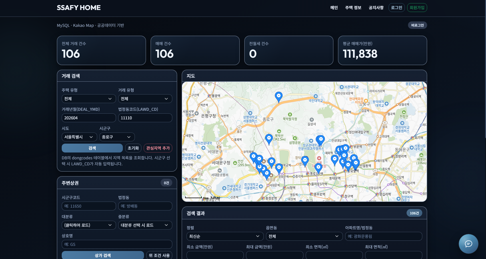

공공데이터 기반 주택 매매 실거래가를 MySQL 에 적재하고, 회원·관심지역 기능과 함께 조회 서비스를 제공하는 SSAFY HOME 프로젝트의 **DB 관통 회차** 결과물입니다. 이번 회차는 기존 파일 영속화(자바 직렬화) 구현을 **MVC 기반의 JDBC + MySQL DAO 계층**으로 전환하는 데 초점을 맞췄습니다.

## 프로젝트 구조

```text
pjt06_buk03_15_12
├─ backend/
│  ├─ pom.xml
│  ├─ ARCHITECTURE.md
│  └─ src/main/
│     ├─ java/com/ssafy/prj/
│     │  ├─ controller/
│     │  │  ├─ AuthController.java
│     │  │  ├─ FavoriteController.java
│     │  │  ├─ MemberController.java
│     │  │  ├─ PropertyController.java
│     │  │  └─ RegionController.java
│     │  ├─ filter/LoggingFilter.java
│     │  ├─ model/
│     │  │  ├─ dao/   (UserAccountDao, FavoriteAreaDao, RealEstateTransactionDao + Impl)
│     │  │  ├─ dto/   (UserAccount, FavoriteArea, RealEstateTransaction, SearchCondition, ...)
│     │  │  └─ service/(UserAccountService, FavoriteAreaService, RealEstateService + Impl)
│     │  └─ util/     (DBUtil, PasswordUtil, TimeUtil)
│     └─ webapp/      (index.jsp, css/, js/, clients/, WEB-INF/)
├─ sql/
│  ├─ SSAFY_HOME_Schema.sql        # dongcodes, houseinfos, housedeals DDL
│  ├─ users_and_favorites.sql      # users, favorite_areas DDL + 시드 회원
│  ├─ notices.sql                  # notices DDL + 시드 공지
│  ├─ boards.sql                   # boards DDL + 시드 게시글
│  ├─ commercials.sql              # commercials, commercial_categories DDL (인덱스 포함)
│  └─ load_commercials_summary.sql # 경량(1/100) 17개 시도 CSV 일괄 적재
├─ scripts/
│  └─ sample_commercials.py        # 원본 CSV → 1/100 경량 CSV 생성
├─ data/
│  ├─ 소상공인시장진흥공단_상가(상권)정보_20260331/   # 원본 17개 시도 CSV (UTF-8)
│  └─ summary/                     # 경량 CSV (스크립트 실행 결과)
├─ reference/                     # JDBC 패턴 참고 (jdbcApp)
├─ reports/
│  ├─ 알고리즘 관통/                 # PJT04 산출물
│  ├─ 웹 관통/                     # PJT05 산출물
│  └─ 웹(back)관통/                # PJT05 백엔드 산출물
└─ requirements/
   └─ 자바전공_SSAFYHome_15기_06_DB.md
```

- 백엔드는 `Controller - Service - DAO - DTO` MVC 구조이며, 영속화 계층은 **Plain JDBC + MySQL** 입니다.
- DAO 메서드는 `Connection` 을 첫 인자로 받고, Service 가 `Connection` 라이프사이클·트랜잭션을 관리합니다 (reference 프로젝트의 관례 준수).

## 기술 스택

- **Backend** : Java 21, Jakarta Servlet 6, Maven
- **Database** : MySQL 8.x (`ssafy_home` 스키마), JDBC (`mysql-connector-j` 8.3.0)
- **View** : JSP + EL + 정적 JS (Bootstrap 5, Kakao Map SDK)
- **JSON** : Jackson Databind 2.18
- **기타** : Lombok, SHA-256 비밀번호 해싱, Tomcat 11

## DB 설계

### 전체 ERD

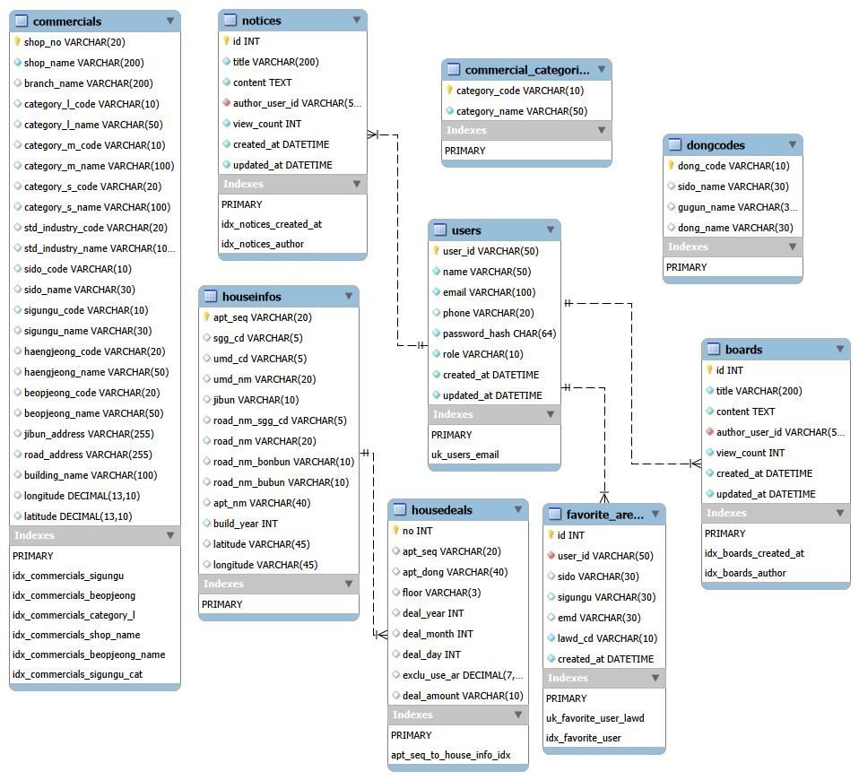

### 테이블 목록 (`ssafy_home`)

| 테이블                  | 역할                                                  | DDL                           |
| ----------------------- | ----------------------------------------------------- | ----------------------------- |
| `dongcodes`             | 법정동 코드 (시도/시군구/동) 마스터                   | `sql/SSAFY_HOME_Schema.sql`   |
| `houseinfos`            | 아파트 기본 정보 (apt_seq, 위치, 위·경도)             | `sql/SSAFY_HOME_Schema.sql`   |
| `housedeals`            | 아파트 매매 실거래 내역 (FK → houseinfos)             | `sql/SSAFY_HOME_Schema.sql`   |
| `users`                 | 회원 (PK = user_id, password_hash CHAR(64), role)     | `sql/users_and_favorites.sql` |
| `favorite_areas`        | 관심지역 (FK → users, ON DELETE CASCADE)              | `sql/users_and_favorites.sql` |
| `notices`               | 공지사항 (관리자 작성, FK → users)                    | `sql/notices.sql`             |
| `boards`                | 공유게시판 (회원 작성, FK → users, ON DELETE CASCADE) | `sql/boards.sql`              |
| `commercials`           | 상가(상권) 정보 (소상공인시장진흥공단, 17개 시도 CSV) | `sql/commercials.sql`         |
| `commercial_categories` | 상권업종 대분류 마스터                                | `sql/commercials.sql`         |

### 관계 요약

```
users (1) ──< favorite_areas (N)              # ON DELETE CASCADE
users (1) ──< notices (N)                     # author_user_id FK (RESTRICT)
users (1) ──< boards (N)                      # author_user_id FK, ON DELETE CASCADE
houseinfos (1) ──< housedeals (N)             # apt_seq FK
houseinfos.sgg_cd + houseinfos.umd_cd ─ dongcodes.dong_code  (조인용)
commercials.sigungu_code   ─ houseinfos.sgg_cd (논리적 매칭, FK 아님)
commercials.category_l_code ─ commercial_categories.category_code
```

### 데이터 적재 상태

- 기본 회원 `ssafy / 1234` 는 `users_and_favorites.sql` 실행 시 자동 생성.
- `dongcodes / houseinfos / housedeals` : 덤프 SQL 적용 완료.
- `commercials / commercial_categories` : `sql/load_commercials_summary.sql` 로 경량(1/100) 17개 시도 CSV 일괄 적재.

## 구현된 기능 (필수 요구사항)

| 번호 | 기능                                | 컨트롤러 → 서비스 → DAO                                                                                        |
| ---- | ----------------------------------- | -------------------------------------------------------------------------------------------------------------- |
| F601 | 주택 실거래가 정보 수집 → DB 저장   | `housedeals/houseinfos` 테이블 적재                                                                            |
| F602 | 주택 실거래가 검색                  | `PropertyController` → `RealEstateService.search` → `RealEstateTransactionDaoImpl` (JOIN 쿼리)                 |
| F603 | 관심지역 정보 관리                  | `FavoriteController` → `FavoriteAreaService` (등록·목록·삭제, 회원 단위)                                       |
| F604 | 주변탐방 정보 수집 (상가/상권 → DB) | `sql/load_commercials_summary.sql` 로 경량(1/100) 17개 시도 CSV 적재 → `commercials` / `commercial_categories` |
| F605 | 주변탐방 업종 정보 검색             | `CommercialController` → `CommercialService.search` → `CommercialDaoImpl` (시군구·동·업종·키워드 필터)         |
| F610 | 공지사항 관리                       | `NoticeController` → `NoticeService` (관리자 등록·수정·삭제 / 일반 사용자 조회·검색, 권한 가드 포함)           |
| F611 | 회원 등록                           | `MemberController?action=register` → `UserAccountService.register`                                             |
| F612 | 회원 조회                           | `MemberController?action=detail / list` → `findByUserId / findAll` (목록은 ADMIN 전용)                         |
| F613 | 회원 수정                           | `MemberController?action=update` → `update`                                                                    |
| F614 | 회원 삭제                           | `MemberController?action=delete` → `delete` (관심지역 CASCADE)                                                 |
| F615 | 로그인 / 로그아웃                   | `AuthController?action=login / logout` → `login` (SHA-256)                                                     |
| F619 | 주택 정보 관리                      | `HouseInfoController` → `HouseInfoService` (목록·상세·관리자 수정, 최근 거래 20건 조인)                        |
| F620 | 공유게시판 (등록·수정·삭제·조회)    | `BoardController` → `BoardService` (회원 글쓰기, 작성자/관리자 수정·삭제, 검색·조회수)                          |
| 추가 | 회원 권한 관리 (ADMIN ↔ USER 토글)  | `MemberController?action=changeRole` → `UserAccountService.changeRole` (관리자 전용)                           |

> 심화 기능 중 **공지사항(F610)·게시판(F620)** 까지 구현 완료. 이외 심화(환경 점검·CCTV)는 본 회차 범위 밖.

## 기능별 화면 및 ERD

### F601. 주택 실거래가 정보 수집 → DB 저장

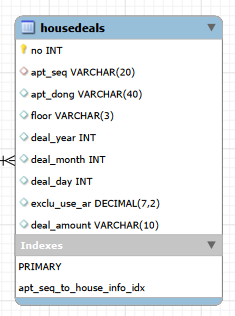
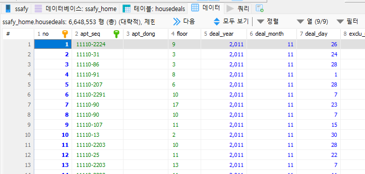

### F602. 주택 실거래가 검색


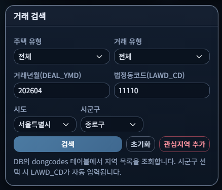
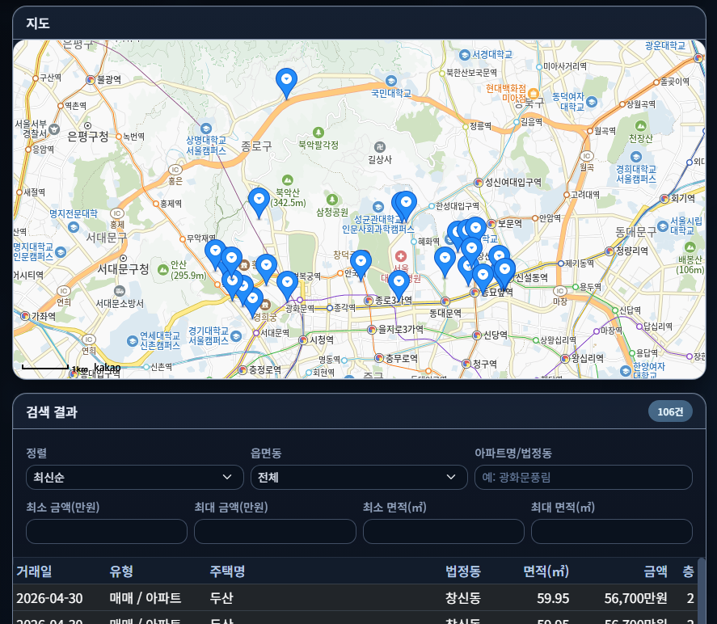

### F603. 관심지역 정보 관리

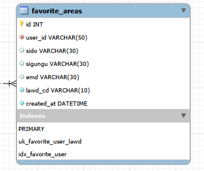
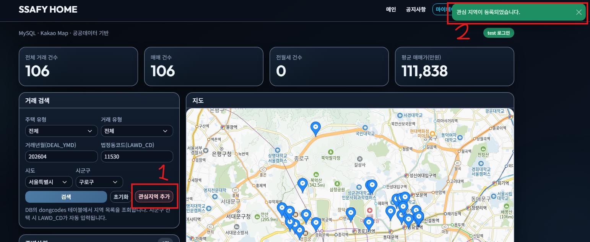
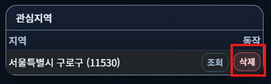

### F604. 주변탐방 정보 수집 (상가/상권 → DB)

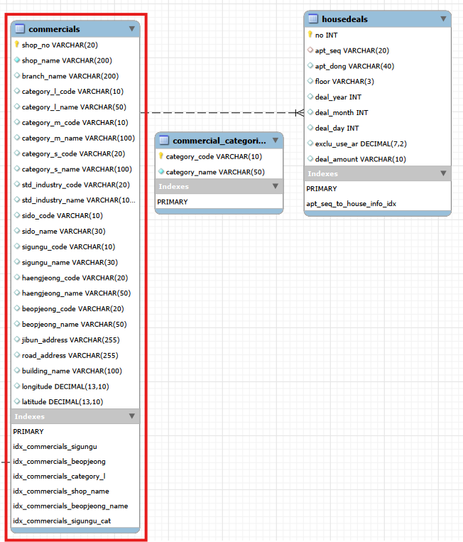
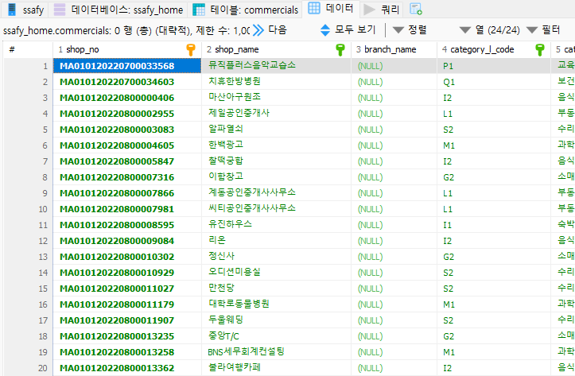

### F605. 주변탐방 업종 정보 검색


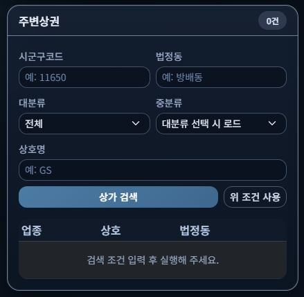
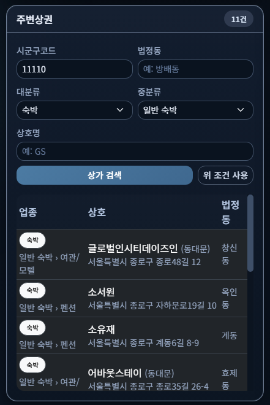

### F610. 공지사항 관리

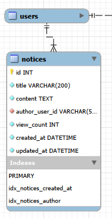
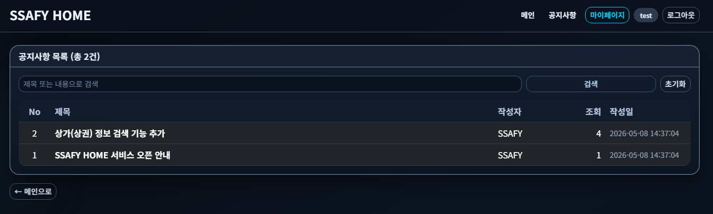
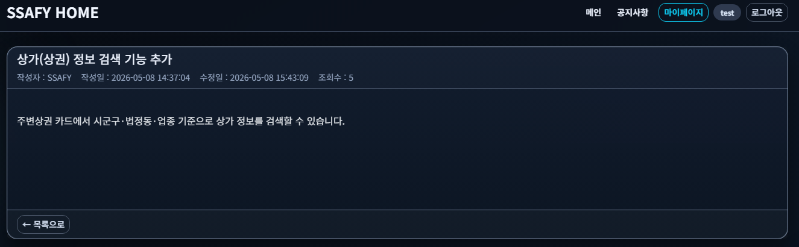

#### 관리자 로그인 시

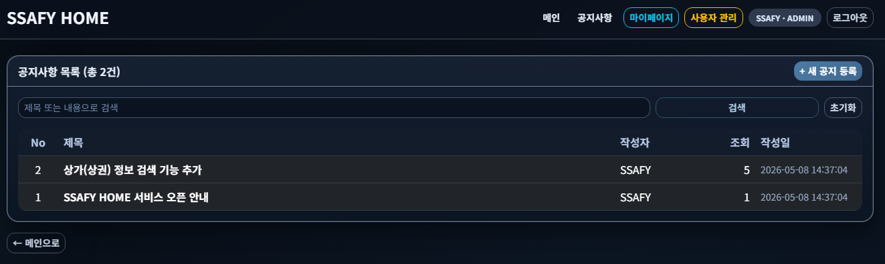
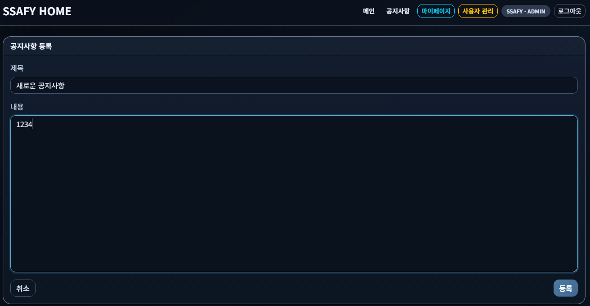
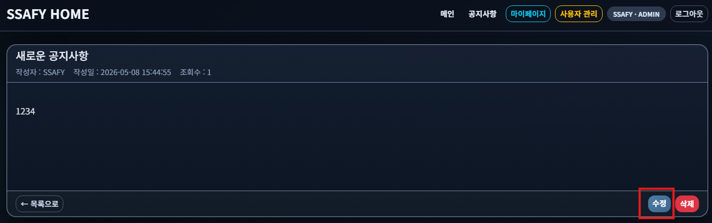

### F611. 회원 등록

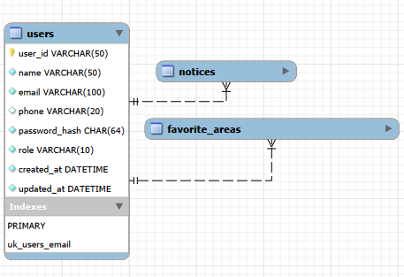
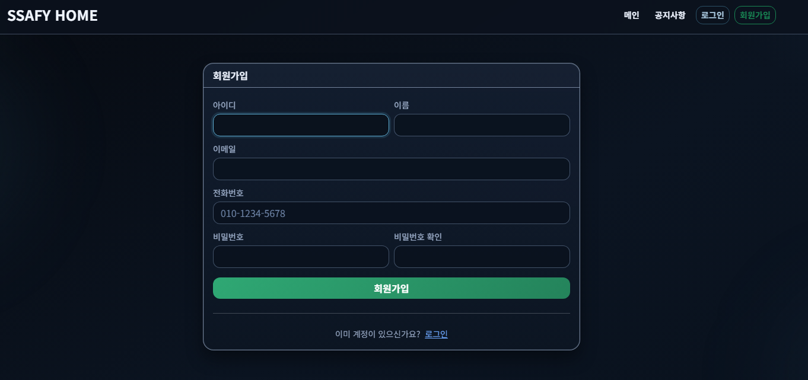

### F612. 회원 조회


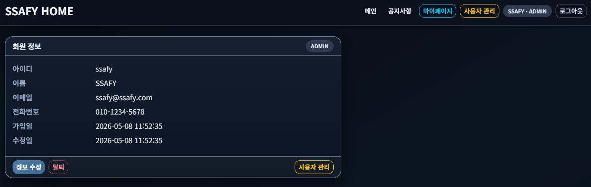
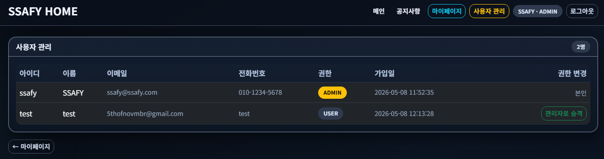

### F613. 회원 수정


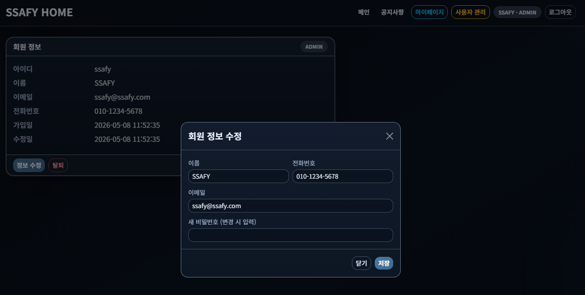

### F614. 회원 삭제


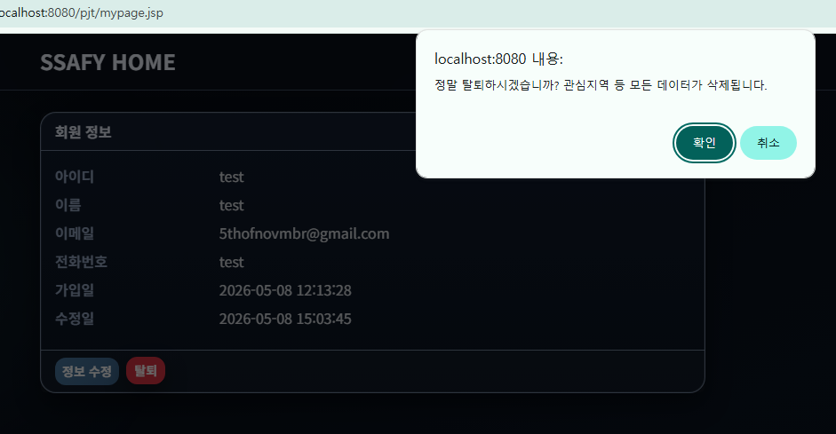

### F615. 로그인 / 로그아웃


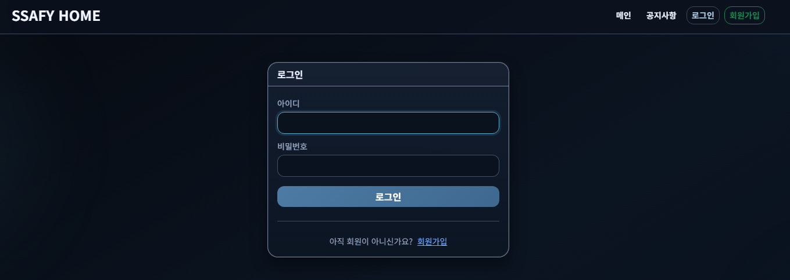
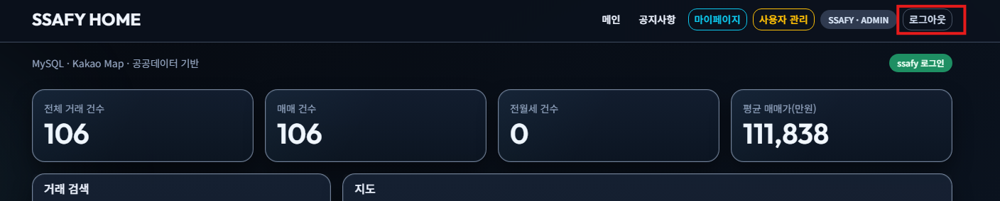

### F619. 주택 정보 관리


### F620. 공유게시판

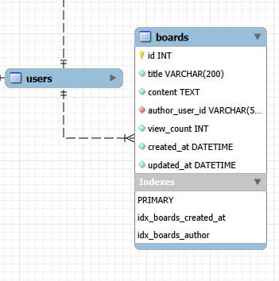
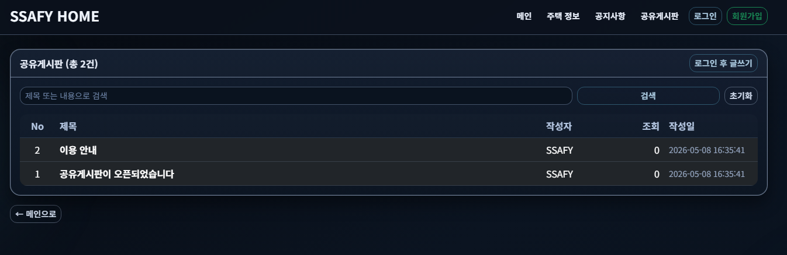
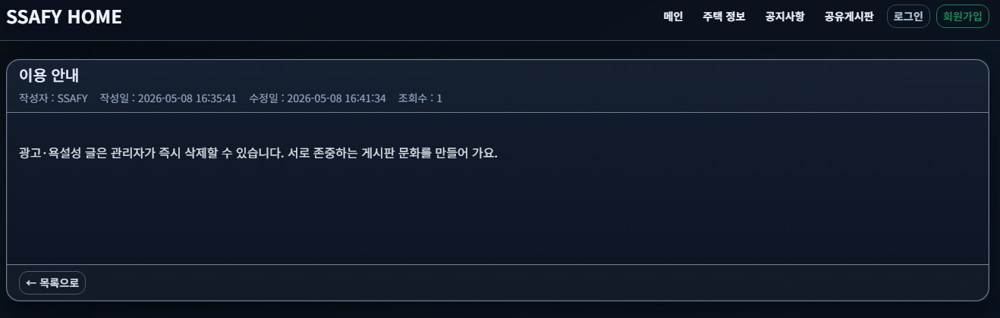
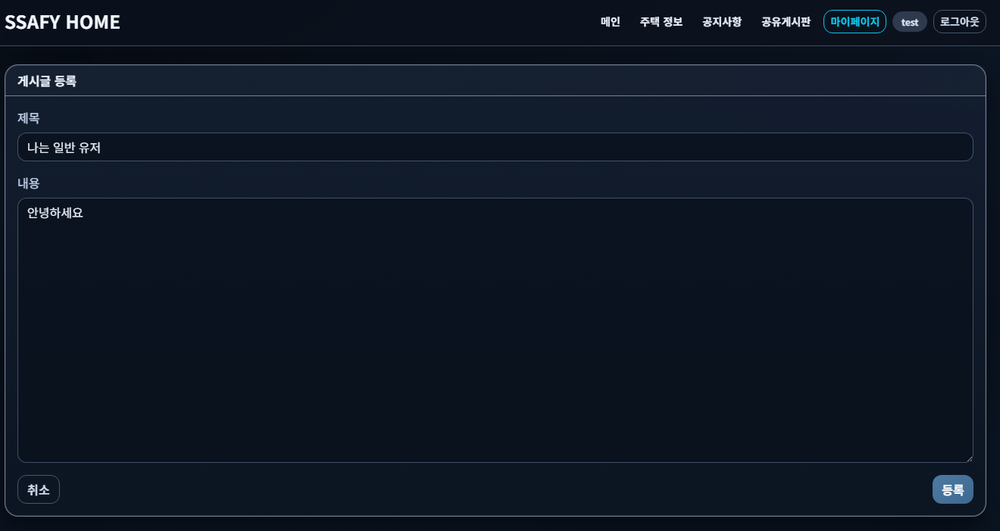
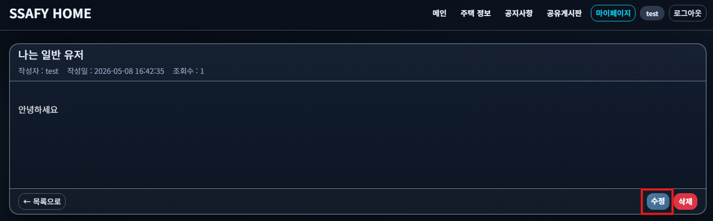

### (추가) 회원 권한 관리


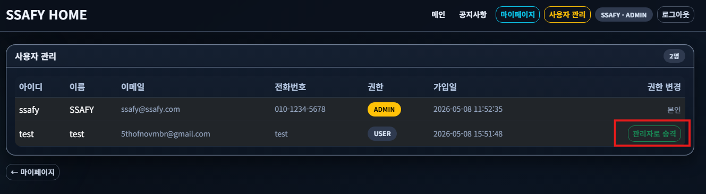

## 실행 방법

### 1. DB 준비

MySQL 8.x 에 `ssafy / ssafy` 계정과 `ssafy_home` 스키마 생성 권한이 있어야 합니다.

```powershell
-- MySQL CLI 또는 Workbench 에서 한 번씩 실행
mysql -u ssafy -p --default-character-set=utf8mb4 ssafy_home < sql\SSAFY_HOME_Schema.sql
mysql -u ssafy -p --default-character-set=utf8mb4 ssafy_home < sql\users_and_favorites.sql
mysql -u ssafy -p --default-character-set=utf8mb4 ssafy_home < sql\notices.sql
mysql -u ssafy -p --default-character-set=utf8mb4 ssafy_home < sql\boards.sql
mysql -u ssafy -p --default-character-set=utf8mb4 ssafy_home < sql\commercials.sql
```

> 파워셸에서 실행되지 않을 경우 cmd, git bash 등 사용

### 2. 부동산 실거래가 데이터 적재

`dongcodes / houseinfos / housedeals` 는 SSAFY에서 제공하는 덤프 파일을 사용합니다.

```powershell
mysql -u ssafy -p ssafy_home < sql\SSAFY_HOME_Dump_2604.sql
```

> 파워셸에서 실행되지 않을 경우 cmd, git bash 등 사용

### 3. 상가(상권) 정보 데이터 적재 (F604)

> 원본 데이터는 17개 시도 합계 약 200만+ 행으로, 인덱스 6개를 유지한 채 적재하면 너무 오래 걸려, **원본의 1/100 크기로 샘플링한 경량 데이터**(약 2만 행)를 사용합니다.

#### 3-1. 데이터 다운로드

1. [공공데이터포털](https://www.data.go.kr/) 접속
2. 검색창에 **`소상공인시장진흥공단 상가(상권)정보`** 입력
3. 파일데이터 선택 → 우측 상단 **다운로드** 클릭 (회원가입/로그인 필요)
4. `소상공인시장진흥공단_상가(상권)정보_YYYYMMDD.zip` 다운로드 후 압축 해제
5. 해제된 폴더를 프로젝트 폴더의 `data/` 아래로 이동:
   ```
   {프로젝트 폴더}\data\소상공인시장진흥공단_상가(상권)정보_YYYYMMDD\
   ```

#### 3-2. 경량 데이터 생성

```powershell
python scripts\sample_commercials.py
```

→ `data/summary/commercials_<region>.csv` 17개 생성됨.

#### 3-3. MySQL 서버 `local_infile` 활성화 (1회)

```sql
SET GLOBAL local_infile = 1;
```

영구 적용은 `my.ini` 의 `[mysqld]` 섹션에 `local_infile=ON` 추가.

#### 3-4. 적재

```powershell
mysql -u ssafy -p --local-infile=1 ssafy_home < sql\load_commercials_summary.sql
```

> 파워셸에서 실행되지 않을 경우 cmd, git bash 등 사용

#### 3-5. 적재 결과 확인

```sql
SELECT COUNT(*) FROM commercials;
SELECT category_l_code, category_l_name, COUNT(*) AS cnt
FROM commercials
GROUP BY category_l_code, category_l_name
ORDER BY category_l_code;
```

대분류 8개(관광/여가/오락, 부동산, 생활서비스, 소매, 숙박, 스포츠, 음식, 학문/교육)가 모두 출력되면 성공입니다.

### 4. WAS 실행 (STS / Eclipse + Tomcat 11)

1. STS 에서 `backend/` 를 Maven Project 로 import
2. Run on Server → Tomcat 11
3. 컨텍스트 패스(보통 `/pjt`)로 브라우저 접속

```
http://localhost:8080/pjt/
```

## API 엔드포인트 요약

| 메서드 | 경로                               | 설명                                                                       |
| ------ | ---------------------------------- | -------------------------------------------------------------------------- |
| POST   | `/auth?action=login`               | 로그인 (세션 생성)                                                         |
| POST   | `/auth?action=logout`              | 로그아웃 (세션 무효화)                                                     |
| GET    | `/auth?action=current`             | 현재 로그인 사용자                                                         |
| POST   | `/member?action=register`          | 회원 가입                                                                  |
| GET    | `/member?action=detail`            | 회원 상세 (본인)                                                           |
| GET    | `/member?action=list`              | 회원 목록                                                                  |
| POST   | `/member?action=update`            | 회원 수정                                                                  |
| POST   | `/member?action=delete`            | 회원 탈퇴 (관심지역 CASCADE)                                               |
| GET    | `/property?action=search`          | 거래 검색 (DEAL_YMD, LAWD_CD, 동, 키워드)                                  |
| GET    | `/property?action=summary`         | 거래 요약 (총 건수·평균가)                                                 |
| GET    | `/favorite?action=list`            | 관심지역 목록                                                              |
| POST   | `/favorite?action=add`             | 관심지역 등록                                                              |
| POST   | `/favorite?action=delete`          | 관심지역 삭제                                                              |
| GET    | `/commercial?action=search`        | 상가 검색 (`lawdCd`, `dong`, `categoryL`, `categoryM`, `keyword`, `limit`) |
| GET    | `/commercial?action=categories`    | 상권업종 대분류 목록 (콤보박스용)                                          |
| GET    | `/commercial?action=subcategories` | 상권업종 중분류 목록 (`categoryLCode` 필터)                                |
| GET    | `/region?action=sido/sigungu/emd`  | 시도/시군구/읍면동 (VWorld 프록시)                                         |

## 산출물

- **README.md** : 본 문서
- **ER 다이어그램** : `images/erd_overall.png` (+ 기능별 ERD 이미지 `images/erd_*.png`)
- **DDL 기준** : `sql/SSAFY_HOME_Schema.sql`, `sql/users_and_favorites.sql`, `sql/notices.sql`, `sql/boards.sql`, `sql/commercials.sql`
- **DB Schema (DDL SQL)** : `sql/SSAFY_HOME_Schema.sql`, `sql/users_and_favorites.sql`, `sql/commercials.sql`
- **데이터 적재 SQL** : `sql/load_commercials_summary.sql` (+ 경량화 스크립트 `scripts/sample_commercials.py`)
- **소스코드** : `backend/src/main/java/com/ssafy/prj/**`
- **아키텍처 문서** : `backend/ARCHITECTURE.md`
- **이전 회차 산출물** : `reports/`

---

UseCase Diagram 및 이전 회차 결과물(알고리즘/웹/웹백) 은 `reports/` 디렉터리를 참고해주세요.
