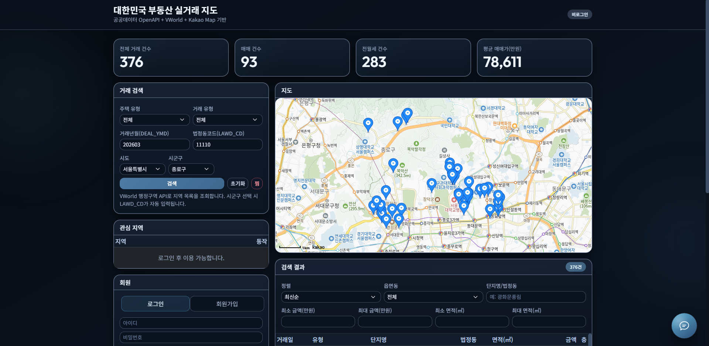

# 부동산 실거래 정보 조회 서비스



공공데이터 기반 거래 정보 조회 화면과 RAG 기반 챗봇 서버를 분리한 프로젝트입니다.
프론트엔드는 `frontend/`, 챗봇 서버와 서버 자산은 `servers/` 아래에 정리되어 있습니다.

## 프로젝트 구조

```text
pjt05_buk03_15_12
├─ frontend/
│  ├─ index.html
│  ├─ css/
│  ├─ js/
│  └─ clients/
│     ├─ index.html
│     ├─ style.css
│     ├─ script.js
│     ├─ script_v1.js
│     ├─ script_v2.js
│     ├─ script_v3.js
│     ├─ script_v4.js
│     └─ sample_data/
├─ servers/
│  ├─ main.py
│  ├─ requirements.txt
│  ├─ data/
│  └─ chroma_data/
└─ images/
```

## 실행 방법

### 1. 챗봇 서버 실행

```powershell
cd servers
.\.venv\Scripts\Activate.ps1
python main.py
```

또는

```cmd
cd servers
.venv\Scripts\activate.bat
python main.py
```

### 2. 프론트엔드 실행

- VS Code에서 `frontend/index.html`을 열고 `Open with Live Server`로 실행합니다.
- 브라우저에서 `http://127.0.0.1:5500/frontend/index.html` 또는 `http://localhost:5500/frontend/index.html`로 접속합니다.
- 챗봇 UI는 `frontend/clients/`에 있고, 메인 화면에서 iframe으로 연결됩니다.

## 서버 자산 위치

- 업로드 문서와 시드 문서: `servers/data/`
- Chroma 벡터 DB: `servers/chroma_data/`

## 기술 스택

- Frontend: HTML, CSS, JavaScript
- Backend: FastAPI, Python
- AI/ML: OpenAI, Sentence Transformers
- Vector DB: ChromaDB
- PDF Parsing: pypdf
